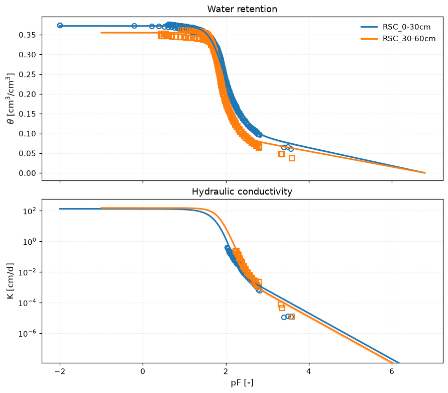
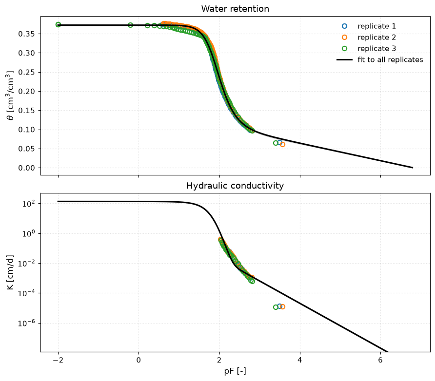
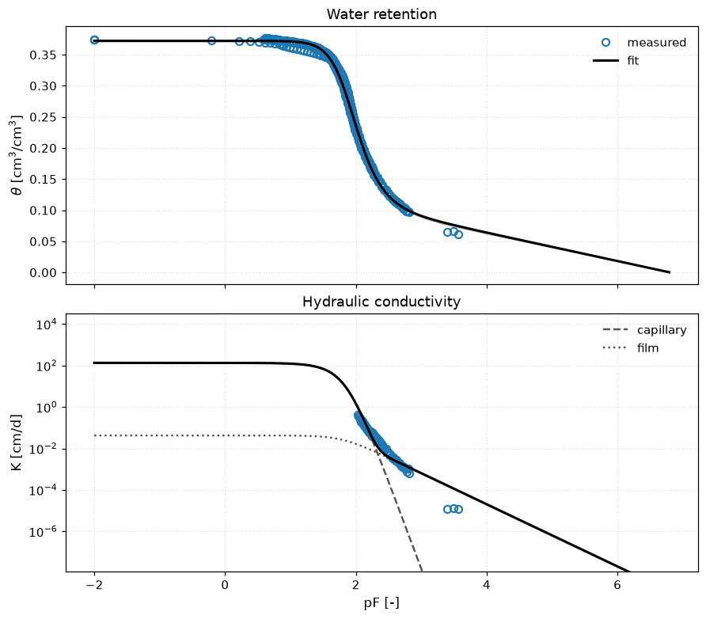
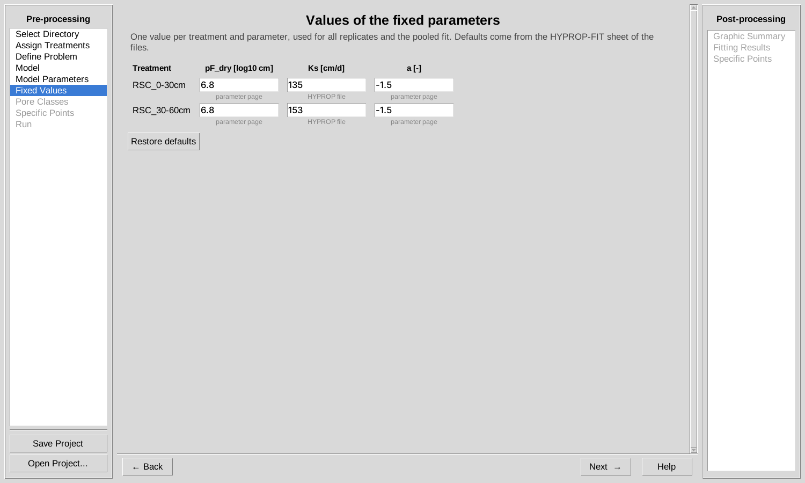
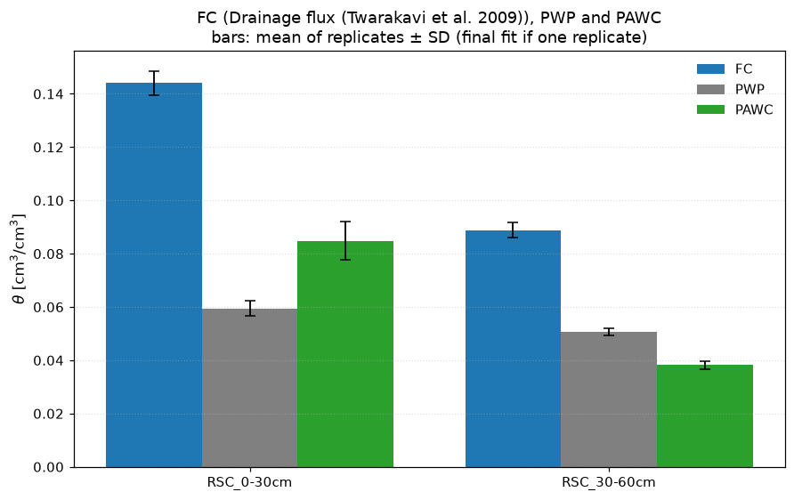

# SoPhyFit-Evap

**Soil physics fitting tool for evaporation-method retention and conductivity data, with 95% confidence intervals.**

SoPhyFit-Evap fits soil water retention θ(h) and unsaturated hydraulic conductivity K(h) to data from the HYPROP evaporation method, one model for both curves. It reports every parameter and every derived quantity (field capacity, wilting point, plant-available water, pore classes) with a 95% confidence interval. It is a Windows desktop program with a step-by-step interface; no programming or Python installation is needed. It is the companion of [SoPhyFit](https://github.com/Tum-Soil-Biophysics/SoPhyFit), which fits retention data from pressure plates and similar methods.

Developed at the [Chair of Soil Biophysics and Environmental Systems](https://www.lss.ls.tum.de/sbe/), Technical University of Munich.

## Features

- **Reads HYPROP-FIT exports directly** (retention, conductivity and WP4 dew-point sheets), or any Excel workbook with a retention sheet and a conductivity sheet, in pF, cm, hPa, kPa, MPa or bar; Vol% or cm³/cm³; log10 K or K in seven units.
- **Six models for both curves:** van Genuchten–Mualem (1980, 1976), Brooks and Corey (1964), Kosugi (1996), bimodal van Genuchten (Durner, 1994), and the PDI variants with adsorbed water and film flow for the dry range (Peters, 2013; Iden and Durner, 2014).
- **Simultaneous fit with error-based weights** (Peters and Durner, 2008), or a sequential fit (retention first).
- **Replicates:** each replicate is fitted, and one more fit is made to all replicates of a treatment pooled.
- **Fixed parameters per treatment:** untick a parameter to fix it; its value per treatment defaults to the value HYPROP-FIT stored in the files (for example a measured Ks), and can be edited.
- **95% confidence intervals on every result:** parameters, θ(h) and K(h) bands, field capacity, wilting point, plant-available water, θ and K at given heads, h at given water contents, pore classes.
- **Field capacity by four methods:** fixed head, inflection point (Dexter and Bird, 2001), drainage flux (Twarakavi et al., 2009), and Assouline and Or (2014).
- **Pore-size distribution and pore classes** (KA5 or user-defined).
- **Free choice of units** for display and output.
- **Outputs:** figures (PNG), Excel workbooks per fit and a summary workbook, text reports.

## Screenshots

| Replicates and the fit to all replicates | Conductivity components of the PDI model |
|---|---|
|  |  |

| Fixed values per treatment | FC, PWP and PAWC per treatment |
|---|---|
|  |  |

## Download and install

1. Go to **[Releases](https://github.com/Tum-Soil-Biophysics/SoPhyFit-Evap/releases/latest)** and download `SoPhyFit-Evap_Setup_<version>.exe`.
2. Run the file and follow the setup wizard. No administrator rights are needed.
3. Start SoPhyFit-Evap from the Start menu. Choose **Load Tutorial 1** to try it with six example files.

Requirements: Windows 10 or 11, 64-bit.

## Updates

SoPhyFit-Evap checks for a new version each time it starts (only the latest version number is requested from GitHub; no data is sent). You can also choose **Help → Check for Updates**. To update, download the new setup file and run it: it replaces the old version and keeps your projects.

To be notified by email, click **Watch → Custom → Releases** at the top of this page.

## Documentation

The **[User Guide (PDF)](docs/SoPhyFit-Evap_User_Guide.pdf)** explains the models, the fitting method, the confidence intervals and every page of the program. It also opens from **Help → User Guide** in the program.

## How to cite

If you use SoPhyFit-Evap in your work, please cite it:

> Zarebanadkouki, M. (2026). SoPhyFit-Evap: Soil physics fitting tool for evaporation-method retention and conductivity data (Version 1.0.0) [Computer software]. Technical University of Munich. Zenodo. https://doi.org/10.5281/zenodo.23628363

The DOI above (10.5281/zenodo.23628363) always resolves to the latest version. Each release is also archived on [Zenodo](https://zenodo.org/communities/tum-sbe) with its own version DOI, listed at the end of the release notes. Cite the version you used.

HYPROP and HYPROP-FIT are products of METER Group. SoPhyFit-Evap is an independent program that reads their exported Excel files.

## Feedback and bug reports

Please use **[Issues](https://github.com/Tum-Soil-Biophysics/SoPhyFit-Evap/issues)** to report a problem or suggest a feature.

## License

Copyright (c) 2026 Mohsen Zarebanadkouki, Chair of Soil Biophysics and Environmental Systems, Technical University of Munich.

SoPhyFit-Evap and its user guide are licensed under the [Creative Commons Attribution-NonCommercial-NoDerivatives 4.0 International License (CC BY-NC-ND 4.0)](https://creativecommons.org/licenses/by-nc-nd/4.0/).

- **You may** use SoPhyFit-Evap free of charge and share the unmodified program and user guide, provided you give appropriate credit (cite SoPhyFit-Evap as shown above).
- **You may not** sell SoPhyFit-Evap or use it for commercial purposes, and you may not distribute modified versions.

See [LICENSE](LICENSE) for the full terms. For commercial use, contact the copyright holder. SoPhyFit-Evap is provided as is, without warranty of any kind.
